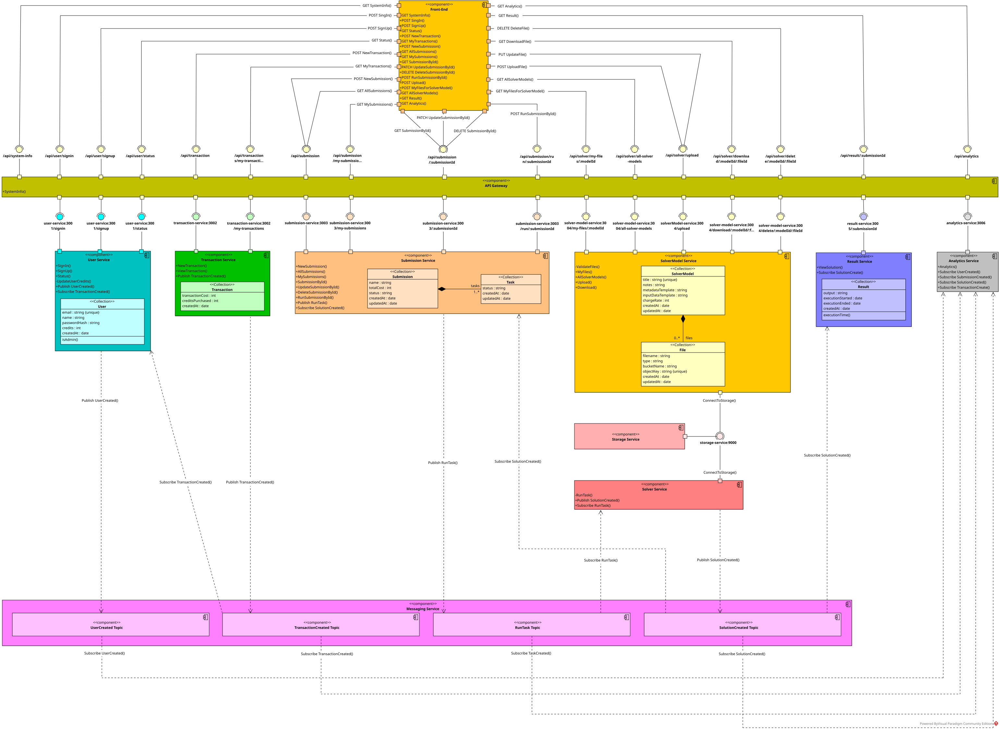
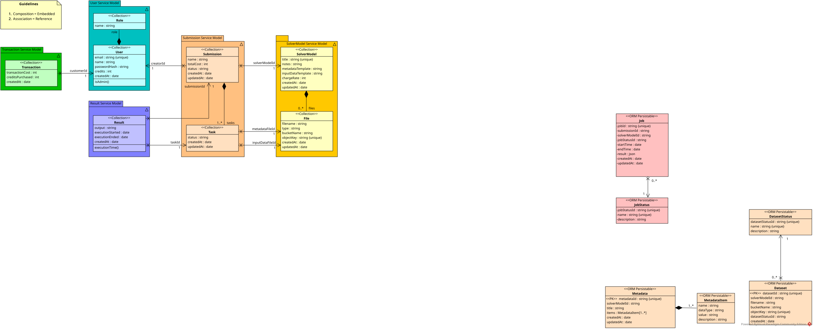
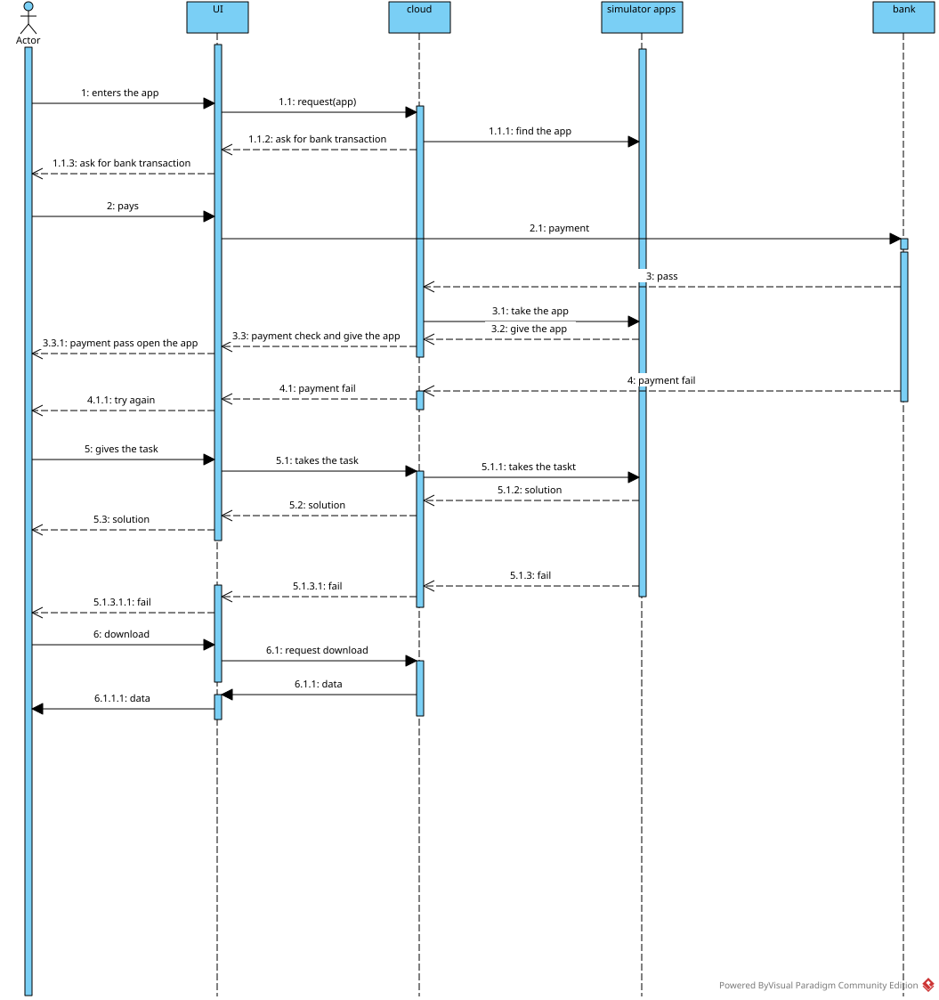

# Solve My Problem

A microservices application developed for the Software as a Service Technologies
course at the School of Electrical and Computer Engineering, NTUA.

Users submit problem data, manage credits, run solver tasks and retrieve results.
The included Python solver uses Google OR-Tools to solve vehicle routing problems.

## Architecture

The frontend communicates with the services through an Nginx API gateway.
RabbitMQ carries events between services, MongoDB stores application data,
MinIO stores files, and Redis supports analytics.

[](UML%20Diagrams/Component%20Diagram.svg)

[Open the full component diagram](UML%20Diagrams/Component%20Diagram.svg).

## Features

- User registration, authentication and account management.
- Credit purchases and transaction records.
- Solver model and input file management.
- Submission creation, task execution and result retrieval.
- Asynchronous processing through RabbitMQ.
- Event-based analytics.

## Technology

| Area | Technologies |
| --- | --- |
| Frontend | Next.js, React, TypeScript and Tailwind CSS |
| Services | Node.js and Express |
| Solver | Python and Google OR-Tools |
| Data and messaging | MongoDB, MinIO, Redis and RabbitMQ |
| Infrastructure | Nginx and Docker Compose |
| Testing | Jest, JMeter and Insomnia |

## UML diagrams

### Class diagram

Service models, their fields and relationships.

[](UML%20Diagrams/Class%20Diagram.svg)

### Sequence diagram

The design illustrates the intended user flow through payment, task execution
and result download. The bank interaction belongs to the design model.

[](UML%20Diagrams/Sequence%20Diagram.svg)

The [UML folder](UML%20Diagrams/) includes the SVG exports and the editable
Visual Paradigm project.

## Run locally

Docker with the Compose plugin is required.

1. Copy the example configuration.

   ```sh
   cp .env.example .env
   ```

2. Edit `.env` and replace all `CHANGE_ME` values with your local settings.

3. Build and start the services.

   ```sh
   docker compose up --build -d
   ```

The frontend is available at http://localhost:3000 and the API gateway at
http://localhost. The user service initializes the administrator account from
the `ADMIN_EMAIL`, `ADMIN_PASSWORD` and `ADMIN_NAME` settings.

To inspect service status or stop the application:

```sh
docker compose ps
docker compose logs --tail=100
docker compose down
```

## Tests and sample data

The [tests folder](tests/) contains integration tests and four sets of routing
input data. Integration tests require running services. Match the credentials
in the test fixtures to the accounts in your local environment before running.

```sh
cd tests
npm ci
npm test -- --runInBand
```

The [JMeter material](documentation/jmeter/) includes test plans and recorded
results for 50, 100 and 200 threads with four loops. These are saved course
measurements.

An [Insomnia collection](Insomnia_2024-09-04.json) is also included. Replace
`REPLACE_WITH_ACCESS_TOKEN` in the API and load-test fixtures with a token from
your local login. The Insomnia login requests use example credentials.

## License

[MIT](LICENSE). Copyright (c) 2026 Nikolaos Tziris.
